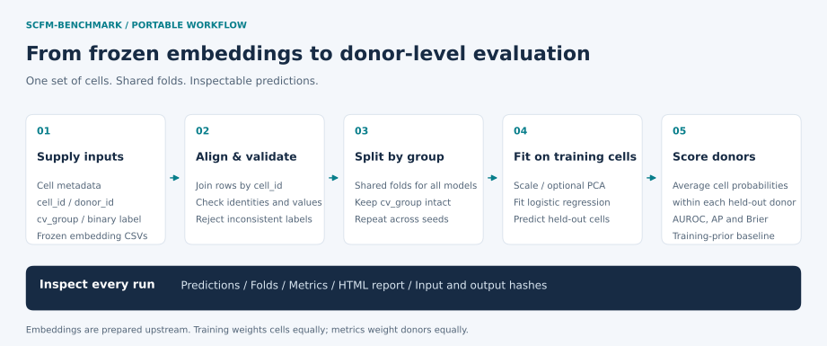
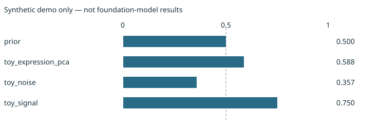
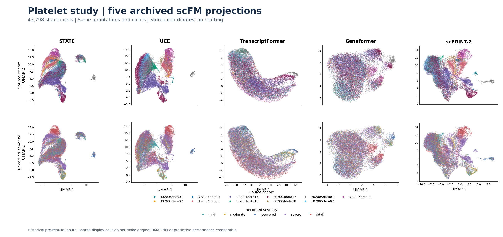

# scfm-benchmark

**Donor-aware evaluation of frozen single-cell representations.**

Turn cell embeddings into an inspectable comparison: align cells by identity,
keep donors and dependency groups together, fit simple probes inside each
training fold, and report held-out predictions at the donor level.

This repository grew out of a single-cell foundation-model research project.
The portable package is now a small, reproducible software demonstration of
its evaluation methods. Historical model rankings are **not** current claims.

## Evaluation workflow



Every representation uses the same cells and folds. Scaling, optional PCA and
the classifier are fitted on training cells; held-out probabilities are then
averaged per donor. The [portable implementation](src/scfm_benchmark/benchmark.py)
exports the predictions, folds, metrics and provenance behind each report.

## Try the demo

Python 3.10+; CPU only. No GPU, model weights, account, network data download,
or patient records are required after installation.

```bash
git clone https://github.com/xqiu625/scfm-benchmark.git
cd scfm-benchmark
python -m pip install .
scfm-bench demo --out demo-output
```

Open `demo-output/results/report.html` in a browser. Use a new output directory
for each run; existing results are never overwritten.



**This preview and the bundled demo use synthetic data.** `toy_signal`,
`toy_noise` and `toy_expression_pca` are generated feature matrices, not outputs
from named foundation models. Their scores do not establish biological utility
or a model ranking. See the [example and output files](examples/benchmark/README.md).

## Platelet case study

The historical platelet study evaluated **STATE, UCE, TranscriptFormer,
Geneformer, scPRINT-2, STACK and scGPT**, with expression PCA baselines.
The case notebook brings those recorded results together with the five models
whose UMAP coordinates are available in the visualization archive.



The gallery displays **43,798 shared cell IDs** with matching annotations and consistent
colors across five models. Each model retains its own stored coordinates and axis
scales. STACK and scGPT are included in the historical benchmark tables; their
matching UMAP files are unavailable in this visualization archive.

These snapshots predate the QC rebuild. Model-specific cell counts and historical
metric definitions remain visible in the notebook; these are archived results,
not a newly validated ranking. The stored severity field also includes outcome-like
labels such as `fatal` and `recovered`.

Open the [platelet Jupyter notebook](examples/platelet/platelet_case_demo.ipynb)
for the seven-model inventory, historical scFM/PCA tables, and five-model UMAP
gallery. An optional final section runs the current donor-aware evaluator on
explicitly synthetic cells. Saved outputs make it readable without execution.
The [case guide](examples/platelet/README.md) covers setup, source files and the
inputs needed for a new real-data evaluation. The
[synthetic quickstart](#try-the-demo) also runs the workflow from the command line.

## What it does

- Aligns every representation to the same cells by `cell_id`; rejects missing,
  extra and duplicated cells, non-finite features, and inconsistent donor labels.
- Uses repeated stratified group folds over donor rows. `cv_group` can bind
  several donors into one dependency block; all models use the same folds.
- Fits scaling, optional PCA and logistic regression on training cells only.
- Averages held-out cell probabilities within donor, then computes donor-level
  pooled out-of-fold AUROC, average precision and Brier score for each repeat.
- Includes a training-prior baseline, CSV predictions/folds, an HTML report,
  input and output hashes, package/source identity and dependency versions.

## Use your own embeddings

Supply one metadata CSV and one or more embedding CSVs. Labels are explicit
binary values, not automatically inferred from clinical severity strings.

`metadata.csv`:

```csv
cell_id,donor_id,cv_group,label
sample-A:cell-1,donor-A,dependency-1,0
sample-A:cell-2,donor-A,dependency-1,0
sample-B:cell-1,donor-B,dependency-2,1
```

This snippet illustrates the schema; a real run needs enough dependency groups
in both classes for the requested folds. Use globally unique cell IDs. If donors
are independent, `cv_group` may equal `donor_id`; shared captures or other known
dependencies require a separately justified grouping. A sample ID is not
necessarily a donor ID. Each donor must have one label and one group.

Each embedding CSV contains `cell_id` and numeric feature columns, with exactly
the same cells as the metadata. Different row order is supported.

```bash
scfm-bench benchmark \
  --metadata metadata.csv \
  --embedding model_a=model_a.csv \
  --embedding model_b=model_b.csv \
  --out benchmark-output --folds 5 --seeds 42 43 44
```

To include a PCA baseline, provide a separate numeric **preprocessed feature**
CSV and add `--embedding expression=features.csv --pca expression=20`. PCA and
scaling are fitted per training fold. The package does not normalize raw counts,
select genes, run QC, or generate foundation-model embeddings.

Python API:

```python
from scfm_benchmark.benchmark import benchmark_from_csv

run = benchmark_from_csv(
    "metadata.csv", {"model_a": "model_a.csv"}, "new-results",
    n_splits=5, seeds=(42, 43, 44),
)
assert run["status"] == "complete"
```

## Interpretation limits

Training weights cells equally; reported metrics weight donors equally. Donor
aggregation does not remove confounding, prove donor identity, or repair leakage
introduced by upstream feature selection, joint preprocessing, pretraining or
fine-tuning. Across-repeat SD is split variability, **not a confidence interval**.
The prior baseline estimates class prevalence from training cells. This binary
probe does not reproduce the historical manuscript's full validation protocol,
provide external-cohort validation, or constitute a clinical prediction tool.

The demo illustrates evaluation mechanics. Real scientific claims need a frozen
cohort, justified dependency mapping, suitable expression baselines and separate
validation. Current research decisions remain in [docs/current-status.md](docs/current-status.md).

## Package and repository

Development version: `1.2.0.dev0`. Install **this checkout** to obtain the new
commands; no PyPI release is claimed. The wheel contains the portable Python
code and generates its own demo inputs. It works without `scripts/`, `configs/`
or this checkout. See [packaging and release notes](docs/package-demo.md).

| Location | Purpose |
|---|---|
| `src/scfm_benchmark/benchmark.py` | Portable evaluation API and report |
| `src/scfm_benchmark/demo.py` | Synthetic fixture and end-to-end demo |
| `tests/test_portable_benchmark.py` | Identity, leakage, output and CLI checks |
| `examples/benchmark/` | Preview and example output |
| `examples/platelet/` | Real platelet case study, source artifacts and interpretation |
| `scripts/`, `reports/`, `archive/` | Preserved research workflows and history |
| `scripts/34_scfm_discovery_framework/` | Later scPRINT-2/discovery work, separate from this demo |

The older `embed`, `evaluate` and `diagnose` commands are checkout/HPCC-specific
research wrappers, not portable package interfaces. `embed` can submit SLURM
jobs; do not use it as a generic model loader. `report` is the older file-index
reporter; the new commands generate their own complete report.

The [pre-demo README](docs/history/README_pre_demo_20261113.md) is retained as a
historical record, not a source of validated current results or submission status.

Development and research verification practices are documented in
[DEVELOPMENT.md](DEVELOPMENT.md).

Related research workflows are maintained in [302033_git](https://github.com/xqiu625/302033_git).

## License

MIT; see [LICENSE](LICENSE).
