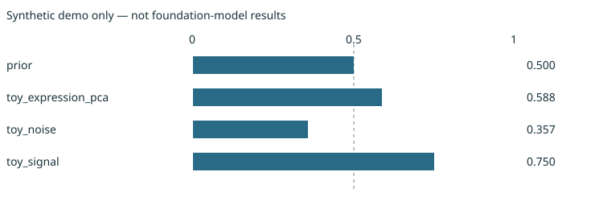

# Synthetic benchmark example

Run from an installed checkout or wheel:

```bash
scfm-bench demo --out new-demo
```

The example creates 320 synthetic cells from 40 synthetic donors. Two donors
share each of 20 CV groups, so donor-only splitting would not satisfy its
intended dependency boundary. It evaluates three generated representations and
a training-prior baseline using the same 3 repeats × 5 folds.

`toy_expression_pca` uses fold-fitted scaling and PCA (5 dimensions). These are
synthetic continuous features, not raw gene counts. `toy_signal` and `toy_noise`
are not actual FM embeddings. The noise file is deliberately reversed to
exercise cell-ID alignment.



The checked-in `metrics.csv`, `folds.csv`, `run.json`, `report.html` and preview
come from the executed synthetic example. Open `report.html` after downloading
this folder; GitHub displays HTML source rather than rendering it. Regenerate
with the command above to obtain the full inputs and donor predictions.

Outputs:

- `inputs/metadata.csv`: identities, dependency groups and binary labels.
- `inputs/toy_*.csv`: generated matrices, keyed by cell ID.
- `results/donor_predictions.csv`: held-out donor probabilities per model/repeat.
- `results/metrics.csv`: pooled donor metrics for each repeat.
- `results/folds.csv`: donor/group test-fold membership.
- `results/report.html`: standalone report, with links to adjacent CSV/JSON files.
- `results/run.json`: parameters, dependency versions, source and artifact hashes.

A directory without a `run.json` marked `complete` is not a completed benchmark.
There are no biological performance claims in this example.
