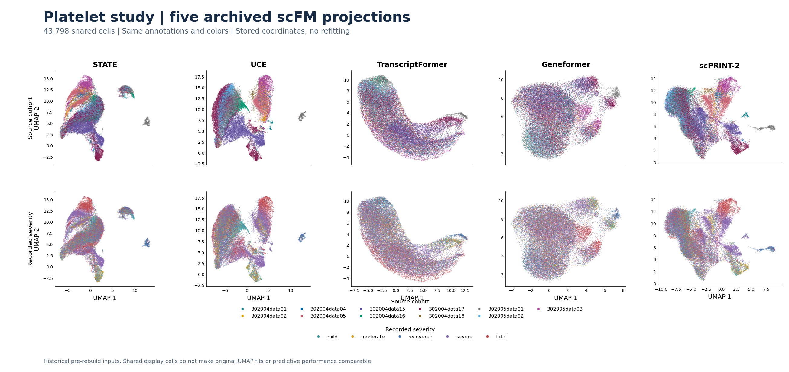

# Platelet study: multiple scFMs

The platelet study ran **STATE, UCE, TranscriptFormer, Geneformer, scPRINT-2,
STACK and scGPT**. This case brings their archived results into one walkthrough,
with PCA baselines and the five models' available UMAP coordinates.

**[Open the Jupyter notebook](platelet_case_demo.ipynb)**. It contains saved tables
and a figure for reading without execution. To run from the repository root in
the environment used by your kernel:

```bash
python -m pip install . jupyterlab
jupyter lab examples/platelet/platelet_case_demo.ipynb
```

Choose **Restart Kernel and Run All Cells**. No GPU, model weights or data download
is required after setup. Keep the checkout's folder structure. Project maintainers
follow the [HPCC execution rules](../../DEVELOPMENT.md).

## Model coverage

The table keeps the disease-matched benchmark population separate from the wider
visualization snapshot. All numbers below describe existing archived files.

| Model | Historical benchmark cells | Stored UMAP cells | Recorded embedding dimensions |
|---|---:|---:|---:|
| STATE | 42,095 | 44,603 | 2,058 |
| UCE | 42,095 | 44,603 | 1,280 |
| TranscriptFormer | 41,315 | 43,798 | 2,048 |
| Geneformer | 41,320 | 43,803 | 1,152 |
| scPRINT-2 | 41,320 | 43,803 | 424 |
| STACK | 42,095 | Not in this UMAP archive | Not recorded in these summaries |
| scGPT | 42,095 | Not in this UMAP archive | Not recorded in these summaries |

A missing UMAP in this archive does **not** mean a model was never run. STACK and
scGPT have rows in the historical benchmark table, which the notebook displays.
These counts do not establish current QC acceptance or donor identity.

## Multi-model gallery



The notebook finds **43,798 shared cell IDs** across the five coordinate files and
verifies that their cohort and severity annotations agree. Every panel displays the
same shared cells and drawing order, with fixed colors for each annotation.
The coverage table reports each model's original cell count and how many cells
are outside this display intersection. The full input files are unchanged.

Columns are models; rows are source cohort and recorded severity. Within a model,
both panels use the same coordinates and axis scales. Across models, UMAP axes
remain independent. The coordinates were originally fitted on different
populations; showing shared cells does not make the original fits identical.
No embedding or UMAP is fitted by this notebook.

The field named `severity` includes `fatal` and `recovered`. These strings are
preserved as recorded, not presented as an ordinal scale or a newly verified
clinical endpoint. Visual separation alone does not establish predictive utility.

## Historical results and the current evaluator

The notebook reads the seven-model LR/RF table and PCA baseline table from
`option_c_primary_benchmark/covid_sepsis_only/`, checking their hashes against
the existing stage manifest. It preserves original field names and includes
`n_cells`, the recorded `n_donors`, `auc_mean` and `auc_std` alongside the results.

The historical [benchmark implementation](../../scripts/24_option_c_canonical_input/code/primary_benchmark_option_c.py)
groups folds by `Sample_ID` and scores held-out cells. This differs from the
current portable evaluator's averaging of probabilities within verified donors.
The archive's `n_donors` is reproduced as recorded, not independently revalidated.
Fold SD is not a confidence interval. Different input populations and the later QC
rebuild prevent treating these archived numbers as a newly validated ranking.
The exact historical runs were not rerun for this demo.

The optional final notebook section calls the existing synthetic generator and
portable evaluator. Its 320 artificial cells, 40 donors and `toy_*` features are
separate from the real study above. It demonstrates how the current evaluation
software works; it does not replace the real study's results.

## Sources and reproduction

- [Stage manifest and checksums](../../scripts/24_option_c_canonical_input/results/manifest.json).
- [Stored UMAP coordinates and per-model summaries](../../scripts/24_option_c_canonical_input/results/option_c_bio_interpretation/).
- [Original visualization producer](../../scripts/24_option_c_canonical_input/code/biological_interpretation_option_c.py) and [launch script](../../scripts/24_option_c_canonical_input/code/run_biological_interpretation_option_c.sh).
- [Seven-model historical benchmark table](../../scripts/24_option_c_canonical_input/results/option_c_primary_benchmark/covid_sepsis_only/mortality_lr_rf.csv).
- [Historical PCA baseline table](../../scripts/24_option_c_canonical_input/results/option_c_primary_benchmark/covid_sepsis_only/pca_baseline.csv).
- [Original single-model figure and provenance](../../docs/assets/readme/README.md), retained for traceability.

Run the notebook to reproduce the gallery; the `platelet-figure` cell is its
plotting recipe. The checked-in PNG is extracted from that cell's actual output.
Each input is verified before use and checked again at the end of execution.

A new real-data evaluation would require frozen original embedding features,
verified donor/dependency mappings and an agreed endpoint, following the
[current research status](../../docs/current-status.md). This case adds visibility
to the existing multi-model study without changing its scientific acceptance.
